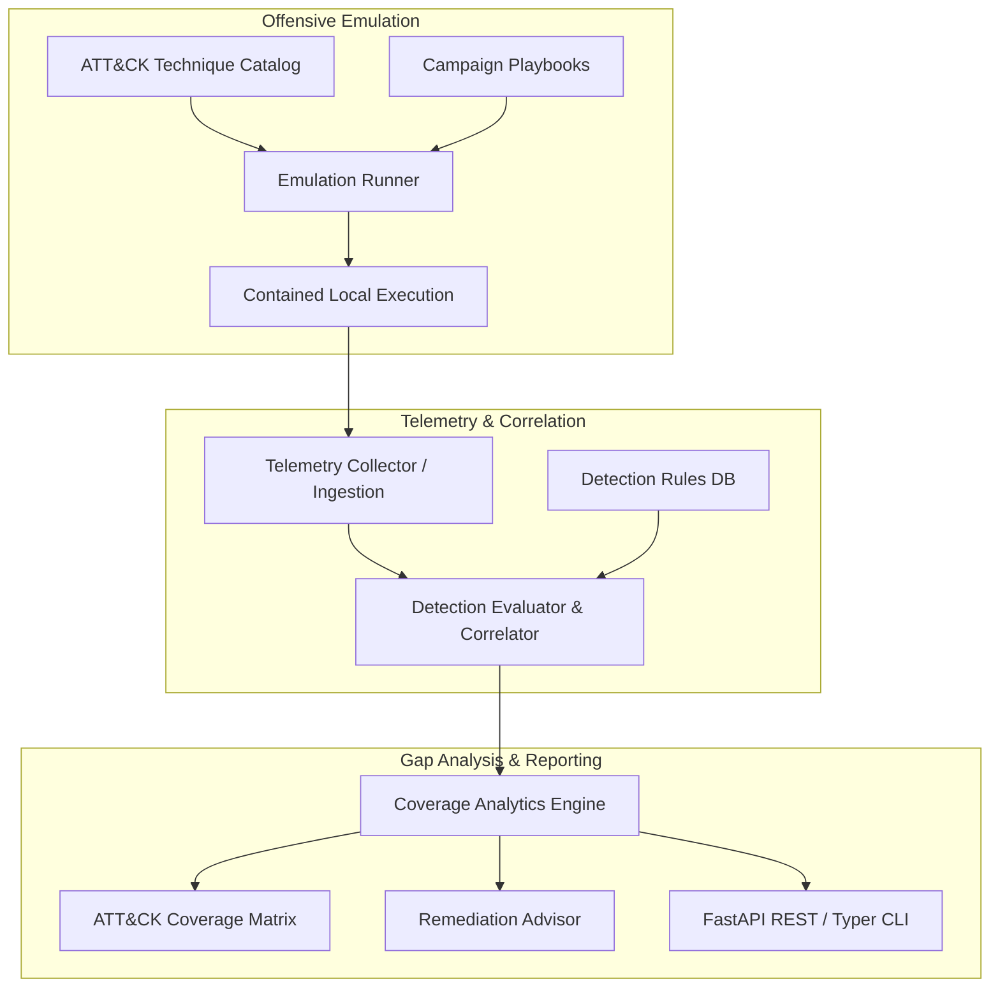

# Purple-Team Cyber Range

Modular adversary emulation, detection verification, and gap-analysis cyber-range platform mapped to MITRE ATT&CK Enterprise.

[](https://github.com/Krish9800/purple-team-cyber-range/actions)
[](https://www.python.org/)
[](https://fastapi.tiangolo.com/)
[](https://typer.tiangolo.com/)
[](https://attack.mitre.org/)

---

## Overview & Problem Statement

Modern security operations struggle with the validation gap: organizations deploy detection rules and SIEM correlation without empirical proof that security telemetry reliably alerts on real adversary techniques.

**Purple-Team Cyber Range** bridges offensive simulation and defensive verification. It emulates synthetic, contained MITRE ATT&CK techniques, captures system and network telemetry, compares expected indicators against observed alerts, and calculates an objective **Detection Coverage Rate (DCR)** with a visual ATT&CK coverage heatmap matrix.

---

## Architecture & Data Flow



---

## Verified Features

- **Adversary Emulation Engine:** Contained, safe execution of atomic procedures across Discovery, Credential Access, Persistence, Privilege Escalation, and Defense Evasion.
- **MITRE ATT&CK Mapping:** Strict tagging against Enterprise ATT&CK techniques (e.g., T1087.001, T1046, T1003.008, T1547.001, T1548.003, T1070.004).
- **Telemetry Correlation:** Automatic correlation between simulated execution timestamps and ingested sensor telemetry.
- **Coverage Analytics & Heatmap:** Quantitative scoring of detection efficacy (True Positives, False Negatives, Visibility Gaps) exportable as ASCII table, JSON, or HTML.
- **Remediation Advisor:** Generates prioritized detection improvement recommendations based on identified blind spots.
- **Dual Interface:** Full-featured Typer CLI and asynchronous FastAPI REST control plane.

---

## Technology Stack

- **Runtime:** Python 3.12+
- **Web API:** FastAPI & Uvicorn
- **Data Validation & Settings:** Pydantic v2 & Pydantic-Settings
- **CLI Framework:** Typer & Rich
- **Testing & Quality:** Pytest, Ruff, Mypy, Bandit

---

## Requirements & Installation

### Requirements
- Linux / macOS / WSL2 on Windows
- Python 3.12+
- SQLite 3.35+

### Installation

```bash
# Clone the repository
git clone https://github.com/Krish9800/purple-team-cyber-range.git
cd purple-team-cyber-range

# Create and activate virtual environment
python3 -m venv .venv
source .venv/bin/activate

# Install dependencies
pip install -e .
```

---

## Configuration

Configuration is managed via environment variables or a `.env` file:

| Variable | Type | Default | Description |
|----------|------|---------|-------------|
| `PURPLE_RANGE_ENV` | string | `development` | Operating environment (`development`, `testing`, `production`) |
| `PURPLE_RANGE_DB_PATH` | string | `sqlite:///./data/range.db` | SQLite database URI |
| `PURPLE_RANGE_LOG_LEVEL` | string | `INFO` | Logging level (`DEBUG`, `INFO`, `WARNING`, `ERROR`) |
| `PURPLE_RANGE_HOST` | string | `127.0.0.1` | REST API bind host |
| `PURPLE_RANGE_PORT` | integer | `8000` | REST API bind port |

---

## Verified Usage Examples

### 1. Command-Line Interface (CLI)

```bash
# Display CLI version and status
python -m purple_range.cli.main version

# List all supported MITRE ATT&CK techniques
python -m purple_range.cli.main techniques

# Inspect a specific technique details
python -m purple_range.cli.main technique T1087.001

# List available multi-stage campaign playbooks
python -m purple_range.cli.main playbooks

# Execute an adversary emulation drill
python -m purple_range.cli.main run --playbook discovery_credential_access

# Display ATT&CK detection coverage heatmap matrix
python -m purple_range.cli.main matrix --format table

# View automated detection tuning recommendations
python -m purple_range.cli.main advisor
```

### 2. REST API Control Plane

```bash
# Start the FastAPI daemon
python -m purple_range.cli.main serve --host 127.0.0.1 --port 8000
```

Interactive OpenAPI documentation is available at `http://127.0.0.1:8000/docs`.

Key Endpoints:
- `GET /health` — Health check and database connectivity verification
- `GET /api/v1/techniques` — List all cataloged techniques and status
- `POST /api/v1/campaigns/run` — Trigger adversary emulation execution
- `POST /api/v1/telemetry/ingest` — Ingest external security telemetry events
- `GET /api/v1/reports/matrix` — Fetch quantitative coverage heatmap data
- `GET /api/v1/advisor/recommendations` — Fetch remediation advisory recommendations

---

## Testing & Quality Gates

The test suite validates emulation safety, detection logic, API contracts, and adversarial inputs:

```bash
# Run complete test suite with coverage
pytest --cov=purple_range --cov-report=term-missing

# Run security and adversarial test cases
pytest tests/security/test_adversarial.py

# Code formatting and linting
ruff check .
ruff format --check .

# Static type verification
mypy src/purple_range
```

---

## Security Model & Threat Boundaries

- **Contained Emulation:** Actions execute within strictly sandboxed user permissions using benign mock procedures (e.g., reading `/etc/passwd` or listing non-sensitive processes) rather than real destructive malware or persistence mechanisms.
- **Zero Weaponization:** Emulation code does not contain unconstrained remote exploits, memory-corruption payloads, or persistence hooks.
- **Input Sanitization:** All telemetry ingestion endpoints enforce strict Pydantic schemas preventing JSON injection or SQL injection.

---

## Limitations & Known Issues

- **Execution Scope:** Techniques are designed for Linux / POSIX environments. Windows-specific techniques (e.g. LSASS memory dumping via Mimikatz) are simulated via telemetry abstraction rather than native Win32 API calls.
- **Live Agents:** Emulation currently runs on the host system where the tool is executed rather than orchestrating remote virtual machines.

---

## Roadmap

- [ ] Docker Compose topology for multi-host network emulation.
- [ ] Export detection rules directly to Sigma and Elastic Common Schema (ECS) YAML.
- [ ] Automated integration with Zeek and Suricata pcap telemetry feeds.

---

## License & Responsible Use

This project is released under the **MIT License**.

> [!CAUTION]
> **Responsible-Use Notice:** This cyber range software is built solely for authorized security assessment, educational research, and defensive detection engineering. Never execute emulation routines on production networks or systems without explicit, written authorization.
